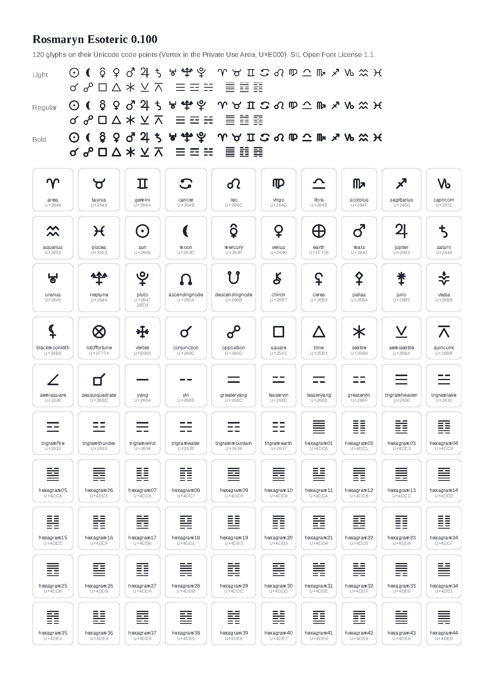

# Rosmaryn Esoteric

An open font of esoteric symbols: the twelve zodiac signs, the planets and luminaries, Chiron, the four main asteroids, Black Moon Lilith, the Lot of Fortune and the Vertex, nine astrological aspects, the Yijing monograms and digrams, the eight trigrams and the sixty-four hexagrams.

Three weights: **Light**, **Regular** and **Bold**. 120 glyphs each, placed on their Unicode code points, so the symbols stay readable in any other font. The Vertex has no Unicode code point and sits in the Private Use Area at U+E000.



## Use

Install the TTF files from `fonts/ttf/`, or load them on a web page:

```css
@font-face {
  font-family: "Rosmaryn Esoteric";
  src: url("RosmarynEsoteric-Regular.ttf") format("truetype");
}
.symbols { font-family: "Rosmaryn Esoteric", serif; }
```

Then type the Unicode characters themselves: `♈ ♉ ☉ ☽ ☌ △ ☰ ䷀`.

## Weights

| Weight | Stroke | Best for |
|---|---|---|
| Light | 1.1 | large sizes, charts, titles |
| Regular | 1.5 | running text, tables |
| Bold | 1.9 | small sizes and screens |

## Build

The fonts are built from the drawings in `sources/glyphes.json` (strokes on a 16-unit grid) with `sources/build.py`, using fontTools, skia-pathops and picosvg:

```
python3 sources/build.py fonts/ttf 1.5 Regular
```

Hexagrams are assembled from their lower and upper trigrams (`sources/hexagrammes.json`, King Wen order, which is also the Unicode order).

## Licence

SIL Open Font License 1.1, see `OFL.txt`. You may use, embed, modify and redistribute the fonts, including in commercial work.

## Français

Police libre de symboles ésotériques : signes du zodiaque, planètes, astéroïdes, aspects, trigrammes et hexagrammes du Yi King, en trois graisses. Chaque symbole est placé sur son code Unicode. Licence SIL Open Font License 1.1.

Made by [Rosmaryn](https://rosmaryn.app/) · [Rosmaryn Library](https://library.rosmaryn.app/)
